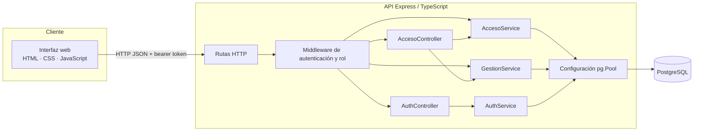

# Diagrama de componentes — Iteraciones 1 y 2

**Roles:** Administrador y Operador pueden matricular nuevos clientes/vehículos, registrar entradas y salidas y consultar ocupación, cada uno con su propia cuenta. El Administrador puede asumir portería cuando el Operador no está; cada matrícula, entrada y salida conserva el ID de la cuenta autenticada. Además, el Administrador gestiona cuentas, clientes y celdas, y solo él renueva o desactiva mensualidades mediante confirmación de contraseña. El Operador puede consultar disponibilidad, pero no administra cuentas ni el catálogo de celdas. El middleware comprueba sesión y rol en servidor.

La persistencia usa `pg.Pool` y SQL desde los servicios; no existe una capa Repository. Los pagos y cobros contables no están implementados. El archivo StarUML debe reflejar estos componentes y relaciones; el código fuente es la referencia para actualizar el diagrama editable.
