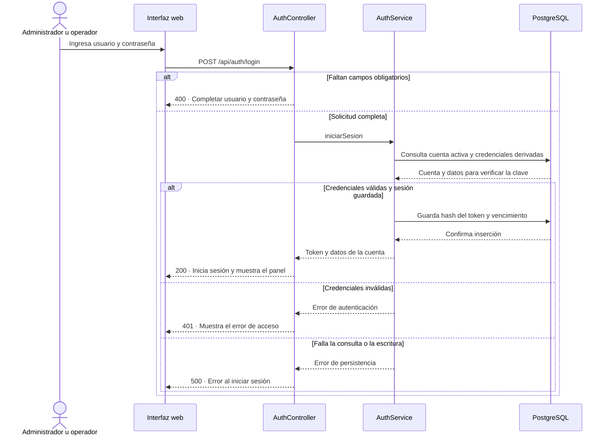
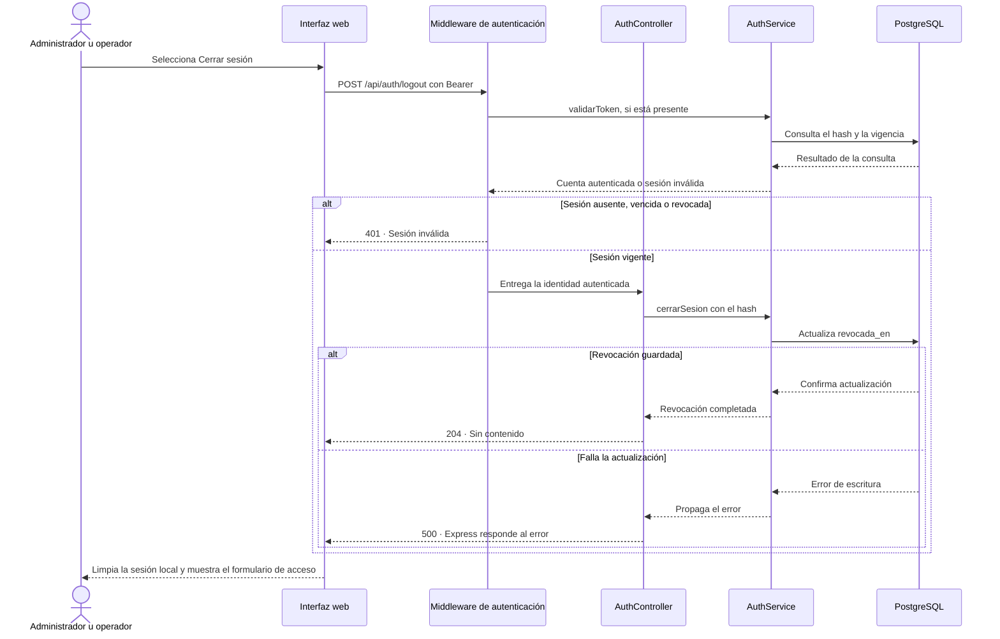
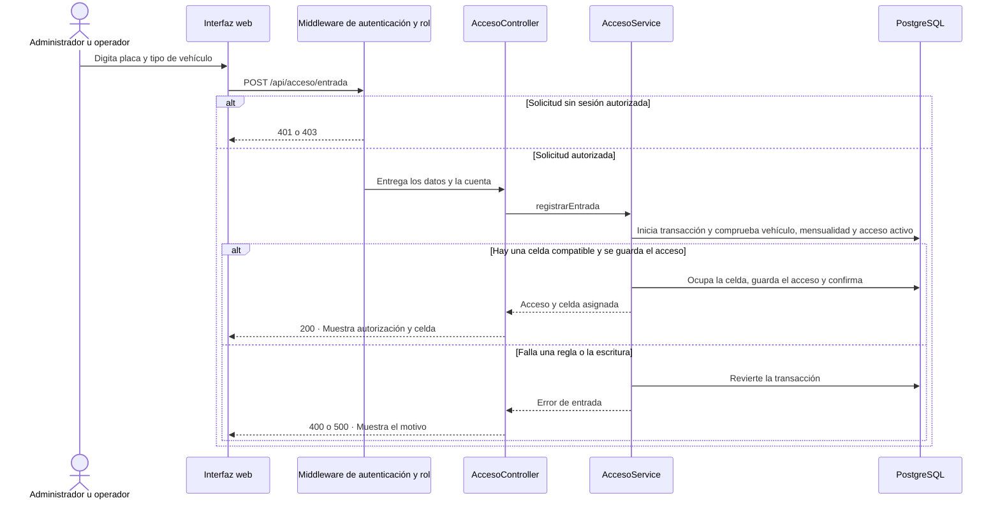
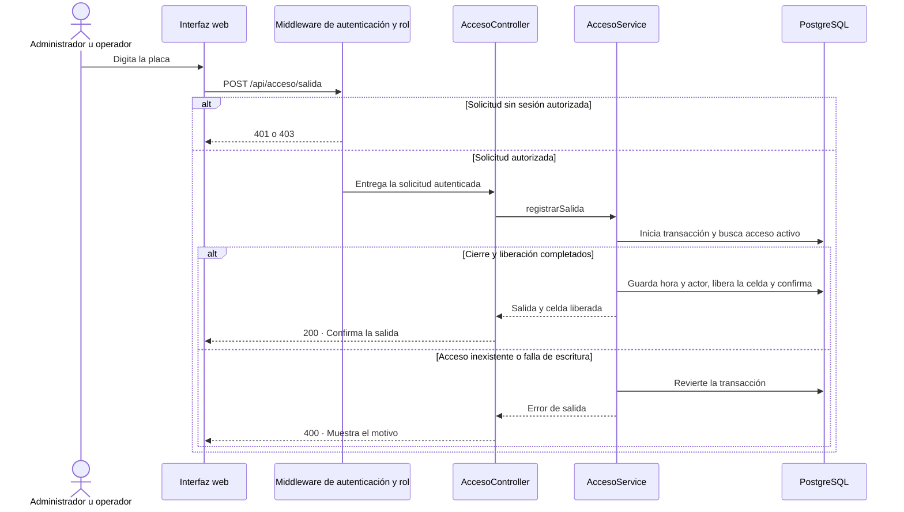
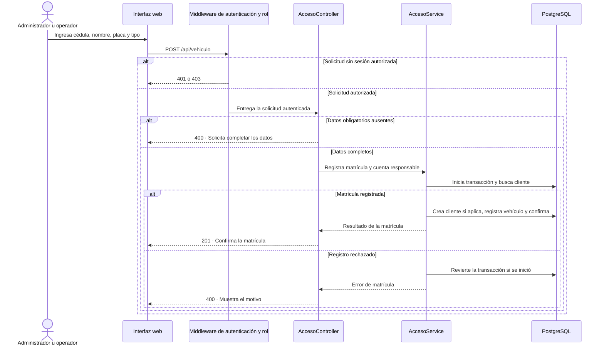
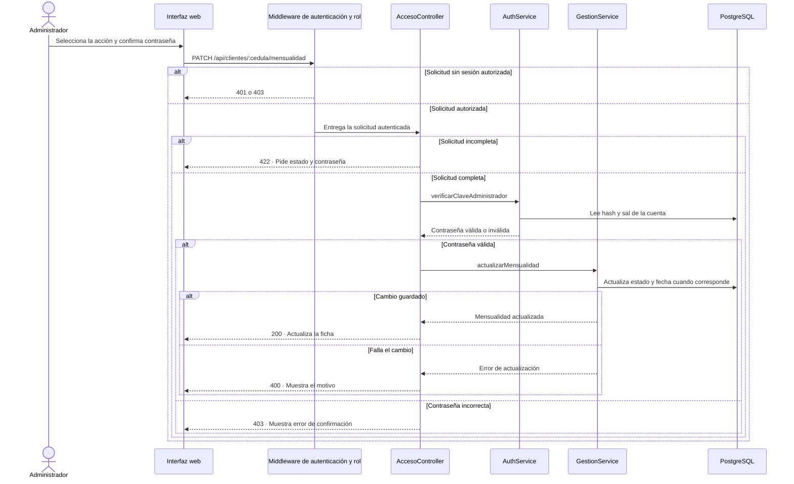
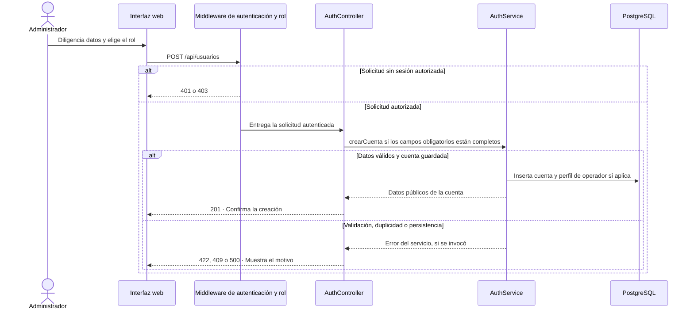
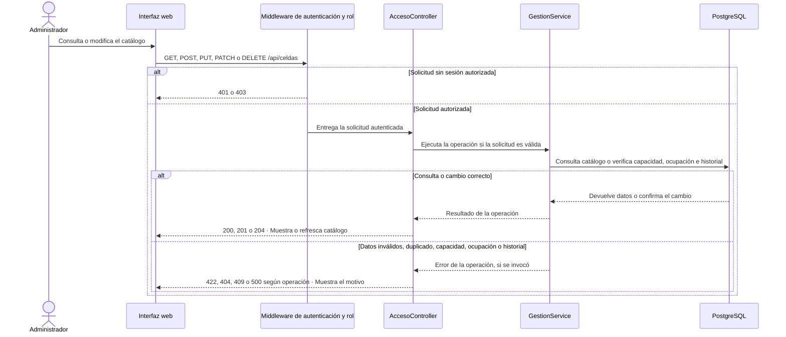

# Diagramas de secuencia de las iteraciones 1 y 2

El archivo [DiagramasSecuenciaI1-I2.mdj](DiagramasSecuenciaI1-I2.mdj) contiene las vistas editables para StarUML.

## I2 · Iniciar sesión

## I2 · Cerrar sesión

## I1 · Registrar entrada

## I1 · Registrar salida atómica

## I2 · Matricular vehículo y cliente

## I2 · Renovar o desactivar mensualidad

## I2 · Crear cuenta de acceso

## I2 · Administrar celdas

